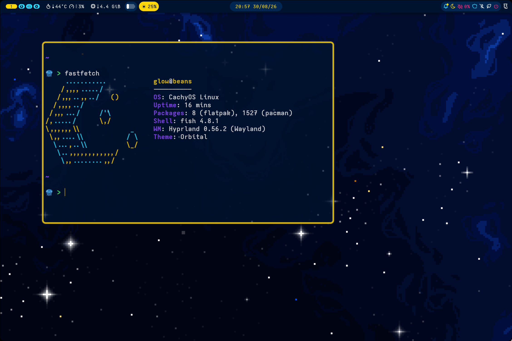
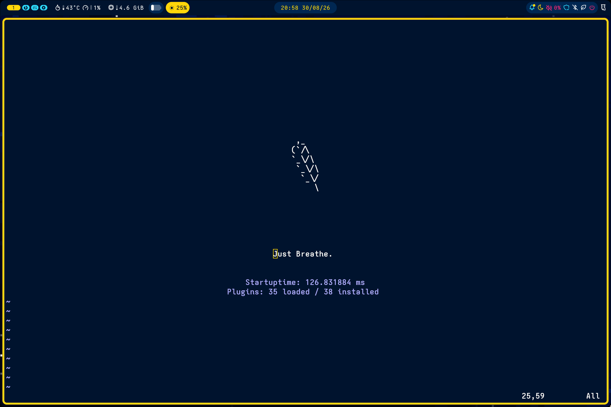
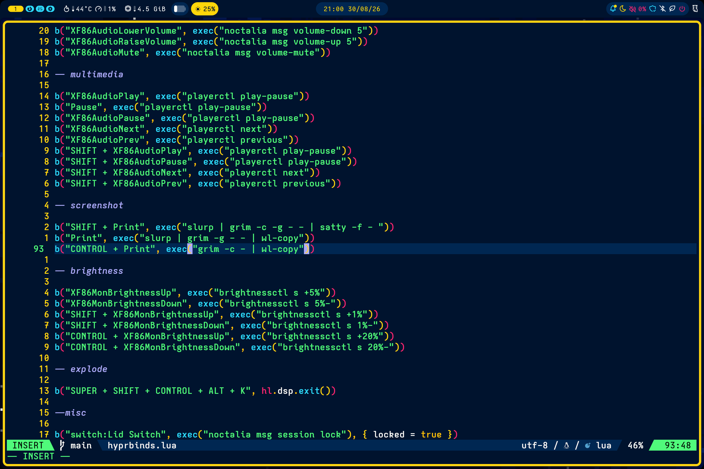
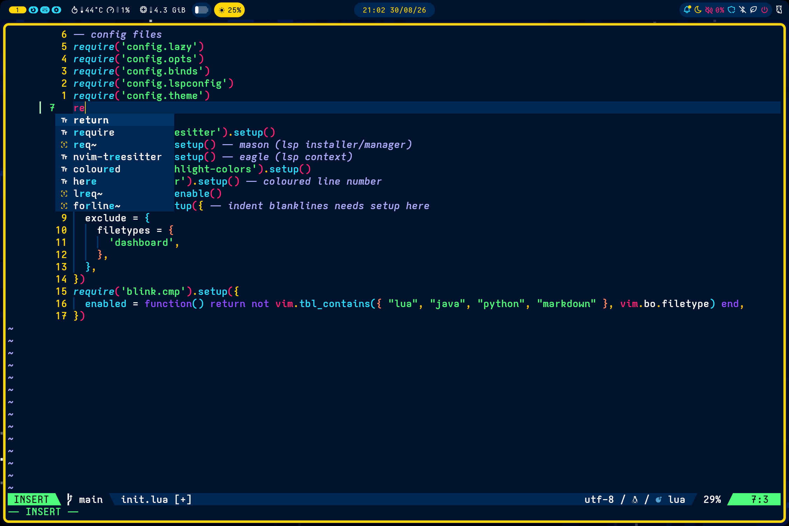

# 🌙 🪼 astral dots repo 🪼 🌙

---

Dotfiles for my setup using [Hyprland](https://hyprland.org/) on [Arch](https://archlinux.org/)

this repo has my configs for:
- [fish (with fisher)](https://fishshell.com/)
- [hyprland](https://hyprland.org/)
- [kitty](https://sw.kovidgoyal.net/kitty/)
- [neovim](https://neovim.io/)
- [starship](https://starship.rs/)
- [noctalia](https://noctalia.dev)

and some others.

---

## screenshots:

---

The font im using is [Fairiesevka](https://github.com/punkfairie/Fairiesevka)

The colour theme is my own homemade theme called goldenrod 💛

This is mainly for me, but if you want to use it or modify it for yourself you're absolutely welcome!
